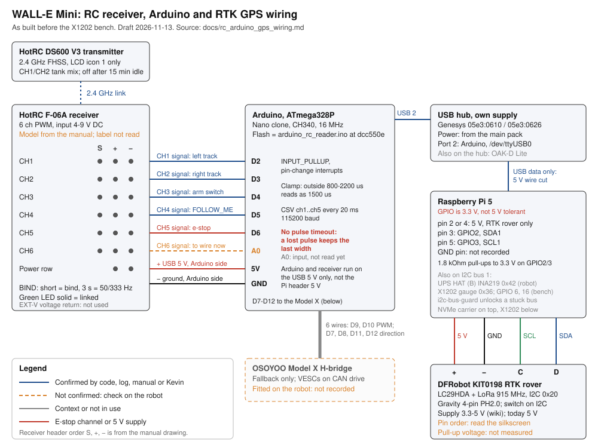

# RC receiver, Arduino and RTK GPS wiring

Status: draft, 2026-11-13. This document records the wiring as built on the
robot before the X1202 bench work. It is the input for a Pi 5 shield
specification (section 11). It does not design the shield.

WARNING: Nobody measured the robot for this document. The robot's Pi is on
the X1202 bench, and the Arduino is not connected to it (`lsusb` on
2026-11-13 12:52 shows only the root hubs). The sources are the code, the
logs, the HotRC DS600 manual and the DFRobot wiki. Section 10 lists each open
check.

## 1. Confidence levels

- **Confirmed:** the code reads the part, a log shows the behaviour, the
  maker's manual gives the value, or Kevin states it.
- **Inferred:** the code or the documents make the item necessary, but
  nobody saw it.
- **Unknown:** no source has the item.

## 2. Diagram

Solid lines are Confirmed. Orange dashed lines are Unknown or Inferred.

## 3. Parts

| Part | Model | Confidence and source |
|---|---|---|
| Transmitter | HotRC DS600 V3, LCD model, sold as Havcybin | Confirmed, 2026-11-04 (`docs/NEXT_SESSION.md`) |
| Receiver | HotRC F-06A: 6 channels, PWM, 4 V to 9 V DC | Inferred. Page 6 of the DS600 manual names the F-06A. Nobody read the label on the robot. |
| RC bridge MCU | Arduino Nano clone: ATmega328P at 16 MHz, CH340 USB serial chip, Nano old bootloader (57600 baud) | Confirmed 2026-11-13: `lsusb` shows `1a86:7523`, avrdude reads signature `0x1e950f` at 57600 baud, and the last flash used FQBN `arduino:avr:nano:cpu=atmega328old`. Nobody photographed the board. |
| Fallback motor driver | OSOYOO Model X H-bridge | The code is Confirmed (`pi_app/hardware/arduino_modelx.py`). Whether the board is fitted is Unknown. |
| USB hub | Genesys Logic, USB IDs 05e3:0610 and 05e3:0626, own supply from the main pack | Confirmed (`docs/ups_hat_b.md`) |
| RTK rover | DFRobot KIT0198: Quectel LC29HDA, LoRa 915 MHz, I2C address 0x20 | Confirmed (`docs/rtk_gps_module.md`) |

DS600 manual (V3, text as outlines, read as images):
<https://www.flyingtech.co.uk/wp-content/uploads/2023/11/DS600-Manual-EN-.pdf>.
DFRobot wiki: <https://wiki.dfrobot.com/kit0198-us/>.

## 4. Receiver to Arduino

| Receiver row | Arduino pin | Use | Thresholds on the Pi |
|---|---|---|---|
| CH1 signal | D2 | Left track. The transmitter mixes the stick (LCD icon 1). | Deadband ±25 µs about 1500 µs |
| CH2 signal | D3 | Right track | The same |
| CH3 signal | D4 | Arm switch | Arm: 1800 µs or more, held for 0.2 s. Disarm: 1200 µs or less, or 0.5 s without a held-high reading. |
| CH4 signal | D5 | FOLLOW_ME | Start at 1800 µs or more while armed. Stop at 1200 µs or less. |
| CH5 signal | D6 | E-stop | 1800 µs or more: stop, latch DISARMED, power the Pi off after 5 s. |
| CH6 signal | A0 | Not used yet | Kevin, 2026-11-13: connect the lead now. The sketch does not read A0, and A0 stays an input. Do not use D7 to D12: the sketch drives them as outputs. |
| + and − | Arduino side, on the USB 5 V | Receiver power | Section 6 (Kevin, 2026-11-13) |

Electrical facts:

- The F-06A has two output modes (manual page 6). Blue LED off: analogue
  servo mode, 50 Hz, 1000 µs to 2500 µs. Blue LED on: digital servo mode,
  333 Hz, 500 µs to 2500 µs. A 3 s press of BIND changes the mode. The logs
  show 992 µs to 2004 µs. The mode on the robot is Unknown.
- The sketch measures each pulse with `micros()` (4 µs steps) in a
  pin-change interrupt. It changes a width outside 800 µs to 2200 µs to
  1500 µs before it sends the line.
- D2 to D6 use `INPUT_PULLUP` (internal pull-up of 20 kOhm to 50 kOhm to
  5 V).
- The manual does not give the signal voltage. An ATmega328P at 5 V reads
  a high level at 3.0 V or more (0.6 × VCC). A 3.3 V output thus has 0.3 V
  of margin. VERIFY (section 10, check 5).

## 5. Arduino to Model X (fallback)

| Arduino pin | Model X pin | Use |
|---|---|---|
| D10 | ENB | Left PWM |
| D7 | IN3 | Left direction 1 |
| D8 | IN4 | Left direction 2 |
| D9 | ENA | Right PWM |
| D12 | IN1 | Right direction 1 |
| D11 | IN2 | Right direction 2 |

The Model X is a hobby motor driver board from the first prototype. Its code
is in the initial commit (2025-08-15), before the VESCs. The VESCs on CAN are
the drive path. The Pi uses the Model X path only when `can0` does not exist
(`pi_app/app/main.py`, "VESC not detected"). A comment in the sketch says that the IN1/IN2
polarity "may need swap depending on wiring". Nobody recorded a check of the
right-side direction.

## 6. Power and ground

- The Arduino gets 5 V from port 2 of the USB hub. The hub has its own
  supply from the main pack. The Pi-to-hub cable has its 5 V wire cut
  (2026-11-05). Thus the Pi does not supply the hub, and the hub does not
  supply the Pi.
- The receiver gets its power from the same USB 5 V as the Arduino (Kevin,
  2026-11-13). The Arduino and the receiver do not connect to the 5 V of the
  Pi header. The exact pin on the Arduino side is not recorded. The F-06A
  takes 4 V to 9 V DC on its power row (manual page 5). The manual note
  gives 12 V as the maximum.
- The RTK rover is the only part in this document on the 5 V of the Pi
  header (Kevin, 2026-11-13).
- The receiver and the Arduino must have a common ground for the PWM
  signals. The USB ground connects the Arduino ground to the Pi ground.
- The RTK rover gets 5 V from the Pi header (section 8).

## 7. Arduino to Pi (USB serial)

- Port: `/dev/ttyUSB0`. The reader tries `/dev/ttyUSB*` first, then
  `/dev/ttyACM*`.
- Rate: 115200 baud. 8N1 is Inferred (the Arduino default).
- Arduino to Pi: one line each 20 ms, `ch1,ch2,ch3,ch4,ch5`, in µs. The
  rate is fixed. It does not follow the receiver frame rate. After a reset,
  the sketch waits 1 s and sends `RC Reader initialized`. The Pi parser
  drops that line, so no log shows it.
- Each time a program opens the port, the DTR line resets the Arduino. The
  Pi start-up opens the port two times (detection, then the reader), so the
  Arduino resets two times.
- Pi to Arduino: `M,<left>,<right>`. The bytes are 0 to 254, neutral 126.
  The sketch accepts 0 to 255, but byte 255 overflows its PWM calculation
  (`abs(delta) * 255` in a 16-bit `int`). The Pi never sends 255.
- The Pi parser accepts a line with 4 or 5 fields only. It drops a line with
  6 fields, so a firmware that sends CH6 needs a Pi change first.
- The Pi puts a monotonic time stamp on each line that it parses. An RC
  frame older than 1.0 s is stale (`RC_STALE_TIMEOUT_S` in
  `pi_app/control/controller.py`).

## 8. RTK rover to Pi (4-pin Gravity connector)

| Rover pin | Signal | Pi header | Confidence |
|---|---|---|---|
| + | Supply | Pin 2 or pin 4, 5 V | 5 V header supply is Confirmed (Kevin, 2026-11-13). The pin number is Unknown. |
| − | GND | A GND pin | The pin number is Unknown. |
| C | SCL | Pin 5, GPIO3, SCL1 | Confirmed: the driver uses bus 1. |
| D | SDA | Pin 3, GPIO2, SDA1 | Confirmed |

- Connector: Gravity 4-pin, PH2.0 (2.0 mm pitch). The kit has a PH2.0-4P
  cable (Inferred from the kit listing). The wiki does not give the pin
  order. Read the order on the board silkscreen.
- Mode switch: I2C. Confirmed: the driver reads the rover at 0x20 on I2C.
- Supply range: 3.3 V to 5 V (DFRobot wiki). This answers the "VERIFY" in
  `docs/ups_hat_b.md`: the rover can operate from the Pi's 3.3 V pin. Nobody
  measured its current. `docs/power_module_spec.md` estimates 0.5 W.
- Other devices on bus 1: the UPS HAT (B) INA219 at 0x42 on the robot, and
  the X1202 MAX17040 gauge at 0x36 on the bench. `i2c-bus-guard.service`
  unlocks a stuck bus (`docs/i2c_bus_guard.md`).
- The Pi 5 has fixed 1.8 kOhm pull-ups to 3.3 V on GPIO2 and GPIO3. If the
  rover board pulls SDA and SCL up to its own 5 V supply, the lines rest
  above 3.3 V. VERIFY (section 10, check 9).
- LoRa: 915 MHz. The base on the barn roof sends the corrections.

## 9. Safety findings

1. **A lost pulse keeps its last value.** The interrupt routines change a
   channel only on a pulse edge. Nothing times out a channel. The sketch
   still sends a line each 20 ms, and the Pi marks each line as fresh. Thus
   the Pi cannot see a channel that has no pulses. Causes: a loose or broken
   signal lead, a receiver without power, or a receiver that stops its
   outputs. Effects: a dead CH3 lead keeps the robot armed. A dead CH5 lead
   removes the e-stop, with no alarm. A dead CH1 or CH2 lead keeps that
   track at its last command, and a release of the stick does not stop it.
   Source: the code (`isrCH1` to `isrCH5` in the sketch,
   `ArduinoRCReader._read_loop`). Not tested on the robot (section 10,
   check 7). The agent review of 2026-11-13 agrees, and adds three cases. A
   loss in the middle of a pulse keeps a short width. A stray edge on a
   loose lead can give 1500 µs: CH3 then disarms after 0.5 s, but CH5
   cannot trigger the e-stop. A channel with no pulse since the last reset
   reads 1500 µs. For a frozen CH3 at 2000 µs, the only backstop is the
   600 s idle auto-disarm, and it needs neutral sticks.
2. **Transmitter off is tested. A link loss with the transmitter on is not.**
   Stand test step 5, 2026-11-11 21:04: Kevin switched the transmitter off
   with the arm switch up. In the next 0.05 s, ch3 read 1004 µs and ch4 read
   1000 µs, and the robot disarmed (`logs/arm_20261111_210328.log` on the
   Pi). During the 3 s off, the journal shows ch3 at 1000 µs and ch4 at
   1004 µs. The data cannot show whether these values are a receiver
   failsafe preset or the last frame of the transmitter as it switches off.
   A link loss with the transmitter on (out of range, or a blocked antenna)
   has no test (section 10, check 6).
3. **The receiver failsafe covers one channel.** The manual (page 2) says
   that the "loss of control protection" protects "the throttle channel".
   The manual does not give the value of the other channels at a link loss.
   With the CH1/CH2 tank mix, the throttle channel is Unknown. To set the
   protection, hold OK while you switch the transmitter on.
4. **The transmitter switches off after 15 minutes without operation**
   (manual page 4). It beeps 1 minute before. By finding 2, this disarms the
   robot. Thus a FOLLOW_ME run with no stick or button input stops at
   15 minutes.
5. **An out-of-range pulse reads as a valid neutral.** The sketch changes
   a width outside 800 µs to 2200 µs to 1500 µs. The Pi accepts 1500 µs as
   valid, so its own "last valid value" rule never runs. A CH5 pulse above
   2200 µs thus hides the e-stop. A CH4 pulse below 800 µs reads 1500 µs, and
   FOLLOW_ME does not stop. The receiver can send 500 µs to 2500 µs. Today
   the logs stay in 992 µs to 2004 µs, at the default (maximum) travel of
   the transmitter. A change of the transmitter travel or of the receiver
   mode can cause this. Latent; source: agent review, sketch line 188.
6. **Low: the Model X path has no motor-command timeout.** If the Pi stops
   sending, the sketch keeps the last Model X command. This is not
   important if the Model X is not fitted (check 8).
7. **Low: `millis()` wraps after 49.7 days.** The CSV timing comparison
   then can stop the CSV. The Pi sees a stale stream and disarms, which is
   safe.

## 10. Open checks

WARNING: Do checks 6 and 7 with the robot on the stand, wheels free, and
`wall-e` stopped. Then the motors cannot move.

1. **Arduino board.** Done 2026-11-13: a CH340 (`1a86:7523`) and an
   ATmega328P with the Nano old bootloader (section 3). Open: photograph
   the board, both sides.
2. **Firmware.** Done 2026-11-13 13:22, with `wall-e` stopped for about
   15 s (Kevin's approval). avrdude read the flash in no-write mode
   (`-n -U flash:r`) at 57600 baud. The first 4,806 bytes are the same, byte
   for byte, as a build of the repo sketch at `dcc550e` (2026-03-01) with
   the Debian toolchain on the Pi (`arduino-builder`, core 1.8.6, avr-gcc
   5.4.0, PinChangeInterrupt 1.2.9-9-g62e4ef1). The builds of `5f275d0` and
   `5aa12e3` do not match. Bytes 4,806 to 9,807 are left from an older,
   larger build of the same reader (they contain `RC Reader initialized`).
   The bootloader writes only the pages of the new program, so old pages
   stay. The program never runs them. The full image is saved as
   `arduino_rc_reader/backup/flash_readback_20261113.hex` (MD5
   `56d5d39e94132cd8263f413f98879282`). To restore the program, upload the
   `dcc550e` build (the same bytes) at 57600 baud. Do not try to write the
   bootloader area of the image through the bootloader.
3. **Receiver label and output mode.** Read the label. Record the blue LED:
   off is the 50 Hz mode.
4. **Receiver power feed.** Answered by Kevin, 2026-11-13: the USB 5 V,
   on the Arduino side. Nothing connects to the header 5 V except the RTK
   rover. Open: the exact pin on the Arduino side.
5. **Signal voltage.** Measure the high level of the CH1 signal with a
   scope, transmitter on. A meter shows the average of the pulse, not its
   high level.
6. **Link loss with the transmitter on.** Run
   `python3 -m pi_app.cli.monitor_rc`. Put the arm switch up. Hold CH1
   forward with a rubber band. Put the transmitter in a closed metal box
   (an unplugged microwave oven is sufficient) for 5 s. Record ch1 to ch5.
   Do it again with the stick released.
7. **Lead loss.** Run `python3 -m pi_app.cli.monitor_rc`. Put the arm switch
   up. Disconnect the CH3 signal lead at the Arduino. Record ch3. Finding 1
   expects ch3 to stay near 2000 µs.
8. **Model X.** Record whether the board is fitted. Kevin did not know the
   board on 2026-11-13, so it is probably not fitted.
9. **Rover pin order and pull-ups.** Read the silkscreen. With the rover on
   5 V and the Pi on, measure the SDA and SCL voltage at rest.
10. **Rover current.** Measure it at 5 V and at 3.3 V.
11. **Header pins.** Record which 5 V pin and which GND pin the rover uses.

## 11. Inputs for the Pi 5 shield specification

Kevin, 2026-11-13: the target is a Pi 5 shield. This section gives the
requirements, the constraints and Kevin's decisions. It does not design the
shield.

Requirements:

- **S1. RC inputs.** Read 6 PWM channels. Accept 500 µs to 2500 µs (both
  F-06A modes). Accept 50 Hz and 333 Hz frames. Resolution: 4 µs or better.
  Report a pulse outside the valid range as invalid, not as 1500 µs
  (finding 5). Test at 333 Hz before you use that mode.
- **S2. No-pulse detection.** Report "no signal" for a channel that has no
  pulse for a set time (proposal: 100 ms, five 50 Hz frames; never less than
  60 ms, three 50 Hz frames). The Pi must treat "no signal" on CH3 or CH5 as
  a disarm. This closes finding 1.
- **S3. Signal levels.** The Pi 5 GPIO is 3.3 V and is not 5 V tolerant.
  The receiver signal level is Unknown. Each RC input must thus accept 3.3 V
  and 5 V signals, and each signal to the Pi must be 3.3 V.
- **S4. Receiver power.** Supply 5 V through a fuse, with a common ground.
  The receiver range is 4 V to 9 V DC, 12 V maximum. The current is Unknown.
- **S5. Receiver connectors.** One 3-pin servo header (S, +, −; 2.54 mm
  pitch) for each of CH1 to CH6, so that the existing receiver leads
  connect.
- **S6. RTK rover connector.** One Gravity PH2.0 4-pin socket on I2C bus 1
  (GPIO2, GPIO3). Supply: the 5 V of the Pi header, as today (Kevin,
  2026-11-13). That 5 V must go off when the Pi halts, so that the rover
  does not drain the cells in storage. The X1202 does this (0 V after a
  halt with the input present, measured 2026-11-13; the halt with the
  input off is still open in `docs/pi_power_architecture.md`). The UPS
  HAT (B) does not. The pull-up voltage at the Pi pins must not be more
  than 3.3 V (check 9). Nothing on the shield may keep the Pi's 3.3 V rail
  up after a halt (refer to "Sneak feeds" in `docs/power_module_spec.md`).
- **S7. Pins and addresses that are in use.** Do not use GPIO 6 (X1202 power
  loss), GPIO 16 (X1202 charge control) or GPIO2 and GPIO3 for other
  functions. Do not use I2C addresses 0x20, 0x36 and 0x42 on bus 1.
- **S8. Mechanical.** Pi 5 HAT+ outline. The X1202 is under the Pi on pogo
  pins, and the NVMe carrier is on top. The shield must stack above the
  NVMe carrier on a stacking header and keep the PCIe ribbon and the fan
  clear. VERIFY the carrier model and its height.
- **S9. USB link.** The 40-pin header has no USB lines. The shield needs a
  USB connector. Kevin has a short USB cable for it (D4).
- **S10. Two 5 V rails that do not connect.** The microcontroller and the
  receiver get their power from the USB VBUS only, as the Arduino and the
  receiver do today (Kevin, 2026-11-13). The RTK rover gets its power from
  the header 5 V only (S6). The two rails share ground and nothing else.
  Reason: on 2026-11-04 the USB hub fed 5 V in both directions through its
  cable, and the Pi carried the hub, the OAK and the Arduino
  (`docs/ups_hat_b.md`). A shield that connects VBUS to the header 5 V
  makes that path again.
- **S11. Two microcontroller positions, one in use at a time.** (a) A
  socket for an Arduino Nano: the current board or a spare. (b) An on-board
  replacement chip: an ATmega328P at 16 MHz with a CH340C USB serial chip,
  the same parts as the Nano, so the sketch and the Pi port discovery do not
  change. Both positions connect to the same receiver headers with the same
  pin map: CH1 to CH5 on D2 to D6, CH6 on A0. Thus one firmware operates on
  both. The on-board chip needs a 16 MHz crystal, a reset circuit with the
  DTR auto-reset capacitor, and a 6-pin ICSP header to load the bootloader
  the first time. WARNING: Never fit the Nano and the on-board chip at the
  same time. Each one has its own USB VBUS, and the two would connect
  through the receiver 5 V rail (S10).
- **S12. The Pi changes first.** The Pi parser must accept 6 fields and the
  "no signal" value before a firmware sends them (section 7). Kevin,
  2026-11-13: the code can come later, but the CH6 wire must exist now.

Second opinion on S11 (Grok, session
`6f2eb58a-e096-4a22-a90d-751115f951fb`, 2026-11-13):

- It agrees with the AVR family and the existing sketch.
- It objects to a bare chip: a bare ATmega328P needs a crystal, a reset
  circuit and a bootloader load through ICSP, and "a CH340" is three
  different circuits. A first-time builder can damage the only working
  board. The Nano socket answers this objection: the known-good Nano stays
  the fallback, and its flash image is saved (section 10, check 2).
- Rejected: its claim that 115200 baud fills up at 333 Hz. The sketch sends
  at a fixed 50 Hz, not at the receiver frame rate. With 6 fields that is
  about 1.8 kB/s, about 16 percent of the link.
- It recommends an RP2040 only as a module (a Pico), and only after the
  protocol and the no-pulse rule work on the Nano.
- Its order of work, accepted: (1) measure the receiver (checks 5 and 6);
  (2) change the Pi parser (S12); (3) add the no-pulse rule and CH6 to the
  sketch on the current Nano; (4) build the shield.

Decisions (Kevin, 2026-11-13):

1. **D1. A microcontroller on the shield reads the RC channels**, as the
   Arduino does today. The Pi does not read the PWM directly.
2. **D3. The CAN interface stays separate** for now.
3. **D4. The microcontroller connects to the Pi by USB.**
4. **D2. The shield has no Model X outputs.** The Model X is a hobby motor
   driver board from the first prototype. Its code is in the initial commit
   (2025-08-15), before the VESCs. Kevin does not know the board, so it is
   probably not fitted (check 8).
5. **D5. The shield has no HAT+ ID EEPROM.** The ID EEPROM is a small
   memory chip on GPIO 0 and GPIO 1 (header pins 27 and 28). The Pi reads
   it at boot to identify the board and to load its settings. The Raspberry
   Pi HAT+ specification requires it only for a board that uses the HAT+
   name. The robot's own code sets up each device, so the EEPROM gives
   nothing here. If the NVMe carrier has an ID EEPROM, a second one at the
   same address on the same pins would conflict. Do not use GPIO 0 and
   GPIO 1 on the shield.
6. **D6. The shield has both microcontroller positions** (S11): a new
   on-board chip, and a Nano socket in case the new chip fails.
7. **D7. CH6 is wired now:** to A0 on the current Arduino, and to the
   microcontroller on the shield. The code reads it later.

## Appendix: Technical Names and Technical Verbs

**Technical Names:** WALL-E, Kevin, Pi, Pi 5, Raspberry Pi, HAT, HAT+,
shield, X1202, UPS HAT (B), NVMe, PCIe, HotRC, DS600, F-06A, Havcybin,
Arduino, Nano, Uno, ATmega328P, CH340, OSOYOO, Model X, H-bridge, VESC, CAN,
`can0`, DFRobot, KIT0198, Gravity, PH2.0, Quectel, LC29HDA, LoRa, RTK, GPS,
I2C, SDA, SCL, GPIO, GPIO2, GPIO3, GPIO 6, GPIO 16, INA219, MAX17040, USB,
USB 2, `/dev/ttyUSB0`, `/dev/ttyACM*`, Genesys Logic, OAK-D Lite, PWM, FHSS,
LCD, LED, BIND, EXT-V, CH1 to CH6, D2 to D12, ENA, ENB, IN1 to IN4,
`INPUT_PULLUP`, `micros()`, pin-change interrupt, CSV, 8N1, baud, µs, kOhm,
VCC, MCU, deadband, failsafe, e-stop, FOLLOW_ME, MANUAL, `wall-e`,
`monitor_rc`, `lsusb`, `i2c-bus-guard.service`, `RC_STALE_TIMEOUT_S`,
`ArduinoRCReader`, journal, silkscreen, servo header, stacking header, pogo
pin, pull-up, sketch, firmware, stand, rubber band, microwave oven, ID
EEPROM, GPIO 0, GPIO 1, VBUS, USB hub, OAK, prototype, A0, avrdude,
`arduino-builder`, avr-gcc, FQBN, bootloader, ICSP, DTR, CH340C, RP2040,
Pico, Grok, flash image, MD5, `millis()`.

**Technical Verbs:** arm, disarm, enumerate, latch, mix, parse, power off,
stack.
